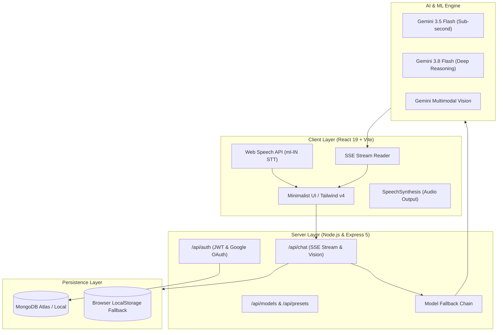

# 🌌 Nebula AI — Intelligent Multilingual Cognitive Assistant & AI Studio

[](https://react.dev/)
[](https://www.typescriptlang.org/)
[](https://tailwindcss.com/)
[](https://expressjs.com/)
[](https://www.mongodb.com/)
[](https://ai.google.dev/)
[](https://github.com)

**Nebula AI** is a production-ready, full-stack cognitive co-pilot and AI assistant engineered with a high-performance **React 19 + TypeScript** frontend, an **Express 5** backend, and **Google Gemini's multimodal reasoning intelligence**. It features real-time Server-Sent Events (SSE) streaming, deep reasoning capabilities, document & image vision analysis, and specialized **Malayalam & English bilingual voice interaction**.

---

## ✨ Key Features

- ⚡ **Real-Time SSE Streaming:** Low-latency token-by-token streaming with zero perceived wait time.
- 🗣️ **Native Malayalam Voice Interaction:**
  - Speech-to-Text configured for Malayalam (`ml-IN`) and English.
  - Interactive speech synthesis response playback.
- 🧠 **Deep Reasoning Engine:** Toggleable step-by-step reasoning tokens utilizing Google Gemini 3.8 Flash preview models.
- 👁️ **Multimodal Vision:** Upload, inspect, and discuss images, screenshots, code diagrams, and charts.
- 🔄 **High-Availability Model Fallback Chain:** Automatic fallback routing (`Nebula 4.0e` $\to$ `gemini-3.5-flash` $\to$ `gemini-3.5-flash-lite` $\to$ `gemini-3.8-flash`) ensuring 99.9% chat uptime.
- 🛡️ **Enterprise-Grade Authentication:**
  - Standard Email + Password with secure bcrypt salt hashing and JWT token validation.
  - One-Tap Google OAuth (GIS / Google Identity Services).
- 🗄️ **Persistent Cloud & Local Storage:** MongoDB session logging with instant local storage fallback when working offline.
- 💻 **Bilingual Terminal CLI (`chat.js`):** Run and chat with Nebula directly from your developer terminal in Malayalam and English.

---

## 🏛️ System Architecture



---

## 📁 Repository Structure

```
AI_Assistant/
├── client/                     # Frontend Application
│   ├── src/
│   │   ├── components/         # ChatInput, ChatThread, Sidebar, TopBar, Hero, Modals
│   │   ├── context/            # AuthContext (JWT & Google Auth state)
│   │   ├── pages/              # AuthPage (Dedicated Login & Register screen)
│   │   ├── types.ts            # TypeScript interfaces & data contracts
│   │   ├── App.tsx             # Main chat application lifecycle & SSE controller
│   │   └── main.tsx            # React root mount
│   ├── public/                 # Static assets, cosmic orb avatars & icons
│   └── package.json
│
├── server/                     # Backend API Server
│   ├── middleware/             # JWT auth & optionalAuth guards
│   ├── models/                 # Mongoose schemas (User, ChatSession, AiModel, UsageLog)
│   ├── routes/                 # Express route handlers (auth.js, models.js)
│   ├── server.js               # Express application entry point & Gemini integration
│   ├── chat.js                 # Terminal CLI Chat interface in Malayalam
│   └── package.json
│
└── README.md                   # Project documentation
```

---

## 🚀 Quick Start Guide

### Prerequisites
- [Node.js](https://nodejs.org/) (v18.0.0 or higher)
- [MongoDB](https://www.mongodb.com/) (Optional: Runs with local storage fallback if not provided)
- A [Google Gemini API Key](https://aistudio.google.com/app/apikey)

### 1. Backend Setup

```bash
cd server
npm install
```

Create a `.env` file in the `server` directory (or copy from `.env.example`):

```env
PORT=5000
GEMINI_API_KEY=your_gemini_api_key_here
GEMINI_MODEL=gemini-3.8-flash
MONGODB_URI=your_mongodb_connection_string_here
JWT_SECRET=your_jwt_secret_key_here
GOOGLE_CLIENT_ID=your_google_oauth_client_id_here
```

Start the backend development server:

```bash
npm run dev
# Or for standard production start:
npm start
```

### 2. Frontend Setup

```bash
cd ../client
npm install
```

Create a `.env` file in the `client` directory (or copy from `.env.example`):

```env
VITE_API_BASE_URL=http://localhost:5000/api
VITE_GOOGLE_CLIENT_ID=your_google_oauth_client_id_here
```

Start the Vite development server:

```bash
npm run dev
```

Open [http://localhost:5173](http://localhost:5173) in your browser.

### 3. Run Developer CLI Chat (Terminal)

You can also converse directly with Nebula in Malayalam from your terminal:

```bash
cd server
npm run chat
```

---

## 🔮 Roadmap: Becoming a Full AI & ML Suite

- [ ] **Document Q&A (RAG):** PDF & Text file vectorization via SentenceTransformers / Gemini Embeddings + ChromaDB / MongoDB Atlas Vector Search.
- [ ] **Fine-Tuned Malayalam LLM:** Integration with custom fine-tuned Gemma-2 / Llama-3 models specialized in Malayalam dialects and literature.
- [ ] **Interactive Canvas / Artifacts:** Side-by-side live execution and preview of generated HTML, React widgets, SVG designs, and Python charts.
- [ ] **Multi-Agent Orchestration:** Agent tool-calling framework for live web search grounding, sandboxed code execution, and data visualization.

---

## 📜 License

This project is licensed under the MIT License — see the LICENSE file for details.

