# 🌌 Nebula AI — World-Class Multimodal Cognitive AI Platform & Studio

[](https://nebula-ai-assistant.onrender.com/)

[](https://react.dev/)
[](https://www.typescriptlang.org/)
[](https://tailwindcss.com/)
[](https://expressjs.com/)
[](https://www.mongodb.com/)
[](https://ai.google.dev/)
[](https://ollama.com/)
[](https://github.com/abhinavsd07-cyber/AI_Assistant)
[](https://stripe.com/)
[](https://cloudinary.com/)
[-brightgreen)](https://github.com/abhinavsd07-cyber/AI_Assistant)
[](https://opensource.org/licenses/MIT)

🌐 **Live Production App:** [https://nebula-ai-assistant.onrender.com/](https://nebula-ai-assistant.onrender.com/)

**Nebula AI** is an enterprise-grade, world-class multimodal artificial intelligence platform designed to rival leading AI ecosystems like ChatGPT, Claude, Cursor, and ComfyUI. Engineered with a blazing-fast **React 19 + TypeScript + Tailwind v4** frontend, an **Express 5** backend, and **Google Gemini's multimodal reasoning models**, it unites cloud intelligence, visual node-graph diffusion workflows, and local open-weights execution.

---

## 🌟 The 8 Extraordinary Pillars of Nebula AI

### 1. ⚡ Nebula FLUX.1 Visual Node-Graph Studio (`/flux`)
- **Interactive Connected Node Pipeline**: Clean, professional visual node-graph interface displaying real-time SVG Bezier data wires across **1. Load AI Models (`UNet GGUF + DualCLIP + VAE`)** → **2. Smart Prompt Input (`Gemini NLP Auto-Enhancer`)** → **3. Image Sampler Engine (`Euler FlowMatch`)** → **4. Final HD Image Output (`1024×1024 Cloud CDN`)**.
- **1,600× Faster Hybrid Architecture**: Generates crisp `1024×1024 HD` renders in **~3–10 seconds** compared to **~85 minutes** on 8GB local RAM swap setups.
- **1-Click Send to Chat & Render Queue**: Inspect historical renders, download full-resolution assets, or dispatch rendered outputs straight into the active conversation.

### 2. 🖥️ Interactive Canvas & Artifacts Studio (`/codex`)
- **Live In-Browser Preview**: When AI outputs HTML, Tailwind CSS, or React (JSX/TSX) code, an interactive split-screen Canvas opens on the right.
- **Standalone React 18 & Tailwind Runtime**: Renders functional React components in a secure sandboxed `iframe` via standalone Babel and Tailwind CDN.
- **Live Code Editor & Viewport Switcher**: Edit source code directly in the Canvas with hot-reloading preview updates across **Desktop**, **Tablet (768px)**, and **Mobile (375px)** viewports.

### 3. 🐍 Autonomous Python Execution Sandbox (Pyodide WebAssembly)
- **Zero-Backend Browser Execution**: Run scientific and analytical Python 3.11 code directly in your browser powered by WebAssembly (Wasm).
- **Interactive Terminal Console**: Real-time standard output (`stdout`), standard error (`stderr`), and return value capture.
- **Data Science Ready**: Compatible with NumPy and Matplotlib for live data visualization.

### 4. 🧠 Long-Term Semantic Memory (MemGPT Architecture) & 3072-dim Vector RAG
- **Automatic Fact Extraction**: Employs zero-shot semantic understanding to automatically extract user facts, language preferences, project stacks, and roles from conversation turns.
- **Cross-Session Persistence**: Stored in MongoDB Atlas and injected into subsequent sessions:
  ```
  [PERSISTENT USER MEMORY]:
  • [IDENTITY] name: Abhinav SD
  • [IDENTITY] role: Senior AI Architect
  • [PROJECT] current_project: Building Nebula AI
  • [PREFERENCE] language: Malayalam and English
  ```
- **3072-Dimension Vector RAG**: Uploads and chunks documents into overlapping windows embedded with `gemini-embedding-001` (`3072` dimensions) for high-precision cosine similarity retrieval.

### 5. 🎨 Zero-Failure NLP Image Generation & Cloudinary CDN
- **Typo & Slang Tolerant (Zero-Shot NLP)**: Deeply understands prompts with heavy typos (`pls generte car image`), phonetic phrasing, and Manglish (`orupadam mammootty`).
- **Real Entity Distinction**: Accurately recognizes living celebrities, actors, and real monuments, fetching authentic high-res imagery and avoiding face distortion.
- **Cloudinary Global CDN (`drxsezyyl`)**: Automatically uploads all generated visuals to high-speed CDN storage with guaranteed 200 OK delivery and zero 404 broken links.

### 6. 🎙️ Real-Time Conversational Voice Mode (`/voice`) & Hybrid Ollama AI
- **ChatGPT-4o Style Liquid Orb**: 3D audio-reactive pulsating cosmic orb visualizer with animated soundwave equalizers.
- **Real-Time Interruptibility & Bilingual Speech**: Natural hands-free speech supporting Malayalam (`ml-IN`) and English (`en-US`).
- **Seamless Hybrid Ollama Engine (`Llama 3.3 70B`)**: Automatically connects to local Ollama daemons when available and seamlessly fails over to high-speed Open-Weights Cloud inference with zero downtime.

### 7. 💳 Official Stripe Sandbox Payment & Subscription Engine (`/pricing`)
- **Live Stripe REST API Integration**: Directly integrated with Stripe `v1/payment_intents` (confirmed `pm_card_visa` transactions) and `v1/checkout/sessions` (Hosted Stripe Checkout).
- **Instant Pro Tier Unlock**: Real-time transaction receipt verification (`pi_3...`) and automatic MongoDB user plan upgrade.

### 8. 🧭 Clean HTML5 History Router & Enterprise OWASP Security
- **Deep-Linkable SPA Routes**: Clean URLs for `/`, `/c/:sessionId`, `/flux`, `/codex`, `/library`, `/explore`, `/settings`, `/pricing`, `/voice`, `/login`, `/signup`, and `/share/:sessionId` with full browser Back/Forward (`popstate`) support.
- **Defense-in-Depth Security**: Protected by OWASP security headers, NoSQL/XSS payload sanitization, Sliding-Window IP Rate Limiting, and PII/Prompt-Injection Guardrails.

---

## 🏛️ System Architecture

```mermaid
flowchart TD
    subgraph Client ["Client Layer (React 19 + TypeScript + Vite)"]
        UI["Minimalist UI / Tailwind v4"]
        Canvas["Interactive Canvas & Artifacts Studio"]
        PySandbox["Pyodide Python Wasm Sandbox"]
        VoiceOrb["Conversational Voice Mode (ml-IN + en-US)"]
        SSE_Recv["SSE Real-time Stream Reader"]
    end

    subgraph Server ["Server Layer (Node.js & Express 5)"]
        AuthRoute["/api/auth (JWT & Google OAuth)"]
        ChatRoute["/api/chat (SSE Stream & Vision)"]
        ModelRoute["/api/models (Dynamic Ollama + Gemini)"]
        MemoryService["services/memory.js (MemGPT Engine)"]
        ImageGenService["services/imageGen.js (NLP Classifier)"]
        GuardrailsService["services/guardrails.js (PII & Injection)"]
        RagService["services/rag.js (3072-dim Vector Search)"]
    end

    subgraph AI_Engines ["Multi-Model AI Intelligence Layer"]
        GeminiFlash["Gemini 3.5 Flash (Sub-Second Latency)"]
        GeminiReasoning["Gemini 3.8 Flash (Deep Reasoning Tokens)"]
        OllamaLocal["Ollama Daemon (Llama 3 / DeepSeek Local)"]
        FluxDiffusion["FLUX / SDXL Latent Diffusion Pipeline"]
    end

    subgraph Cloud_Infrastructure ["Cloud & Data Persistence Layer"]
        MongoDB[(MongoDB Atlas / Sessions & Memories)]
        CloudinaryCDN["Cloudinary Global CDN (drxsezyyl)"]
    end

    UI --> ChatRoute
    Canvas --> PySandbox
    ChatRoute --> MemoryService --> MongoDB
    ChatRoute --> ImageGenService --> CloudinaryCDN
    ChatRoute --> GuardrailsService
    ChatRoute --> RagService
    ChatRoute --> GeminiFlash
    ChatRoute --> GeminiReasoning
    ChatRoute --> OllamaLocal
    GeminiFlash --> SSE_Recv --> UI
    ImageGenService --> FluxDiffusion
    AuthRoute --> MongoDB
```



---

## 🧪 Automated AI Benchmark Evaluation Suite

Nebula AI features an automated test harness validating production readiness across 4 critical pillars:

```bash
cd server
npm test
```

```
=======================================================
   🧪 NEBULA AI - AUTOMATED AI/ML EVALUATION SUITE     
=======================================================

▶ Running Suite 1: Safety Guardrails & PII Redaction...
[PASS] Safety › PII Redaction (Phone & Credit Card) (3 items redacted)
[PASS] Safety › Adversarial Prompt Injection Detection (Attack pattern identified)
[PASS] Safety › Benign Prompt Pass-Through (Zero false positives)

▶ Running Suite 2: 3072-dim Vector RAG & Semantic Retrieval...
[PASS] RAG › Cosine Similarity Math (Identical Vectors = 1.0)
[PASS] RAG › Cosine Similarity Math (Orthogonal Vectors = 0.0)
[PASS] RAG › Semantic Chunking Sliding Window (Split into overlapping chunks)
[PASS] RAG › Gemini 3072-dim Embedding Generation (Dimension: 3072)
[PASS] RAG › Semantic Retrieval Precision (Top-1 Ranking) (Score: 75.8%)

▶ Running Suite 3: Cloud Infrastructure & Services...
[PASS] Cloud › Cloudinary CDN Authentication (Cloud: drxsezyyl, Status: ok)

▶ Running Suite 4: LLM Latency & Inference Benchmark...
[PASS] Inference › Sub-Second LLM Latency (<2500ms) (Latency: 789ms)

=======================================================
   📊 BENCHMARK SUMMARY: 10/10 PASSED (100.0%)
=======================================================
```

---

## 🚀 Quick Start Guide

### Prerequisites
- [Node.js](https://nodejs.org/) (v18.0.0 or higher)
- [MongoDB Atlas](https://www.mongodb.com/cloud/atlas) or local MongoDB
- A [Google Gemini API Key](https://aistudio.google.com/app/apikey)
- A [Cloudinary Account](https://cloudinary.com/) (Free tier)

### 1. Backend Setup

```bash
cd server
npm install
```

Create `server/.env`:
```env
PORT=5000
GEMINI_API_KEY=your_gemini_api_key_here
GEMINI_MODEL=gemini-3.5-flash-lite
MONGODB_URI=your_mongodb_atlas_connection_string
JWT_SECRET=your_jwt_secret_key
CLOUDINARY_CLOUD_NAME=drxsezyyl
CLOUDINARY_API_KEY=your_cloudinary_api_key
CLOUDINARY_API_SECRET=your_cloudinary_api_secret
OLLAMA_HOST=http://127.0.0.1:11434
```

Start the backend:
```bash
npm start
```

### 2. Frontend Setup

```bash
cd ../client
npm install
npm run dev
```

Open [http://localhost:5173](http://localhost:5173) in your browser.

---

## 🌐 Production Cloud Deployment Guide

### Deploy Frontend to Vercel
1. Push this repository to GitHub.
2. Sign in to [Vercel](https://vercel.com/) and click **Add New Project**.
3. Select your repository, set the root directory to `client`, and click **Deploy**.
4. Add environment variable: `VITE_API_URL=https://your-backend-service.onrender.com`.

### Deploy Backend to Render
1. Sign in to [Render](https://render.com/) and create a **New Web Service**.
2. Select your repository, set root directory to `server`, build command to `npm install`, and start command to `node server.js`.
3. Add the environment variables from your `server/.env`.
4. Your API is live with HTTPS and automatic deployments on git push!

---

## 📜 License

This project is licensed under the **MIT License** — feel free to customize and expand!
